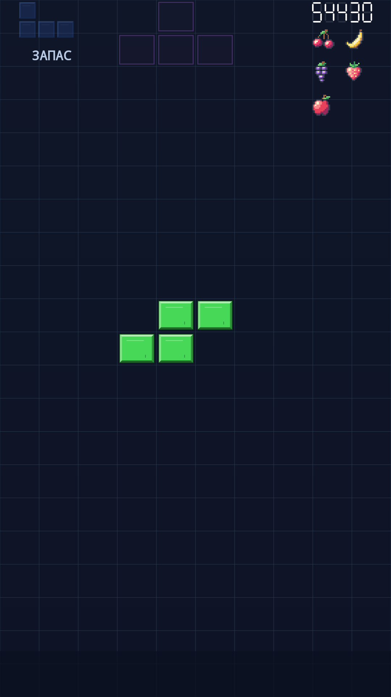
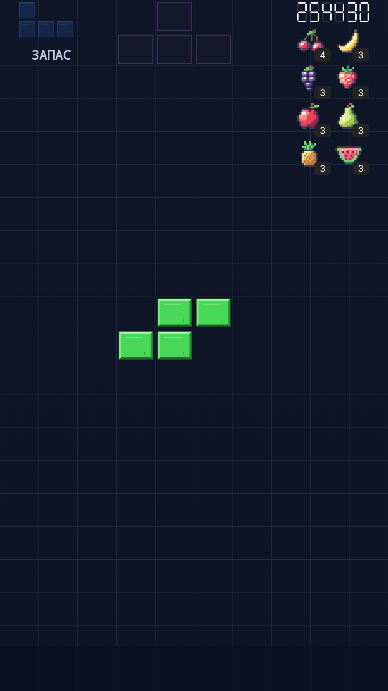

# Fruit HUD implementation evidence (#259)

The approved [mockup](https://raw.githubusercontent.com/RoyMatus/Swypetris/158ae75f62f70d8ba581a6a0bd9c8e101a2c3068/publishing/design/fruit-hud-259/approved-mockup.png) was compared with both native 1080 x 1920 portrait captures below. These are actual GameContent renderer captures on API 35, with deterministic board/score fixtures, not generated mockups. Production fruit sprites, board geometry, Hold, score, colors and layering are retained. The reference photo and incidental generated board contents are not production requirements.

| Five fruits, score 54430 | Eight fruits, score 254430 |
| --- | --- |
|  |  |

Both columns have stable equal slots. The unpaired apple stays in the left column. The right capture shows cherry 4 and all other fruits 3, using small charcoal rounded lower-right badges with light numerals. Badge space is reserved when count is one. Existing score-lane width still follows score digit width; increasing only badge digits does not move or resize artwork.

Focused instrumentation: BorderlessHudTest, HudLayeringTest and MusicSettingsFruitTest passed 11 cases / zero skips in 107.825 seconds. New coverage checks 0–8 types, quantities 1/2/3/4/9/10/13, 240/320 dp portrait widths, font scales 1/2, and light/dark palettes. Existing pixel assertions exercise falling-piece occlusion of both artwork and badges. Capture-only direct instrumentation passed one repeated case in 3.416 seconds to retrieve images before Gradle uninstalls the fixture application; this is not additional unique coverage.

The mandatory exact-head/current-base local PR gate is separate; see the PR for its result. No physical-device or human-playtest claim is made.

The mandatory UI preflight exposed a pre-existing sharesheet fixture isolation defect: asynchronous global Back was delivered after its test finished, closing the following ComponentActivity. Retained per-case logs show the late key dispatch and Activity pause/destruction; the affected layout case passed alone. The fixture now waits for the application-window return event and visible Compose root before restoring automation settings. Existing background-to-menu behavior is allowed. All three AbsoluteVictoryUiTest cases passed after repair in 62.411 seconds. This changes test cleanup only and retains sharesheet, portrait-layout and animation assertions.
