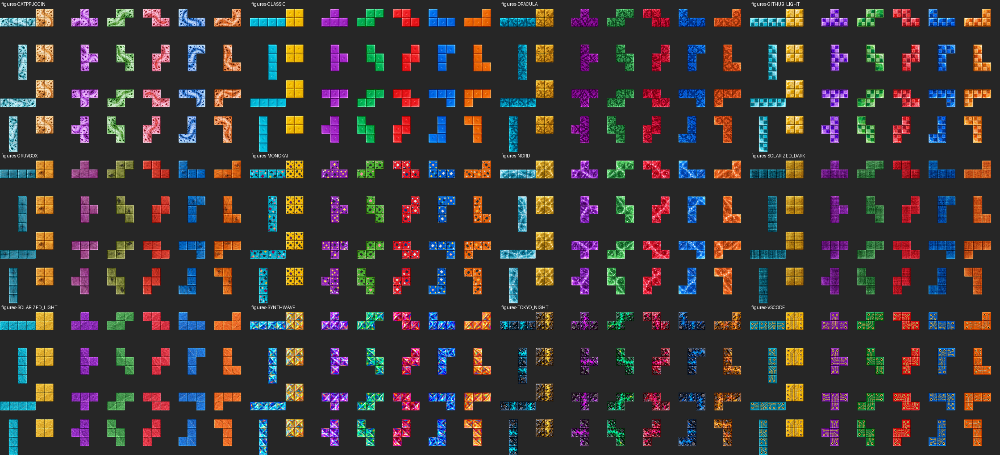
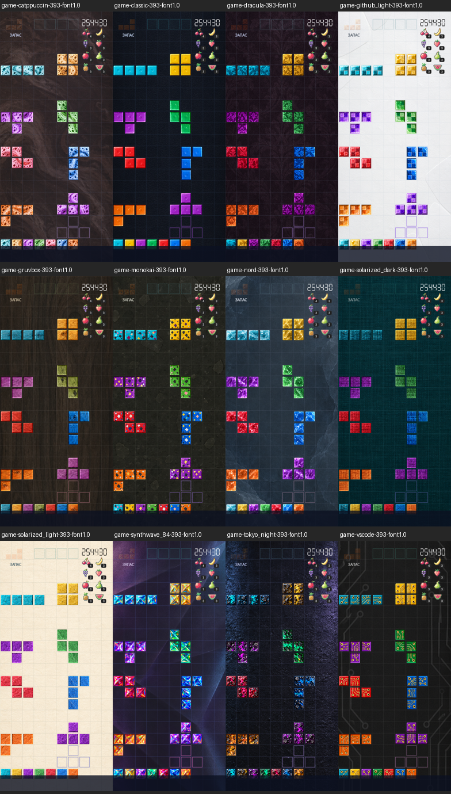
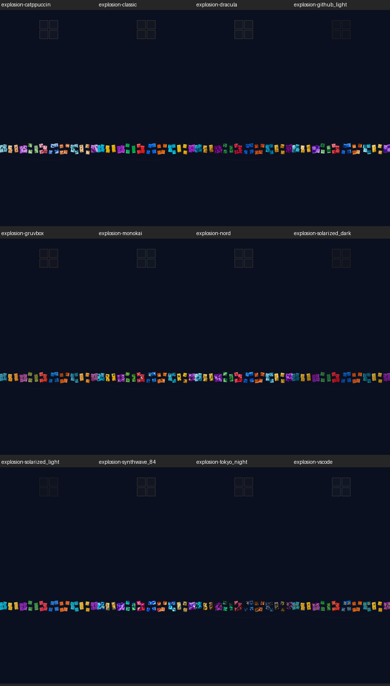
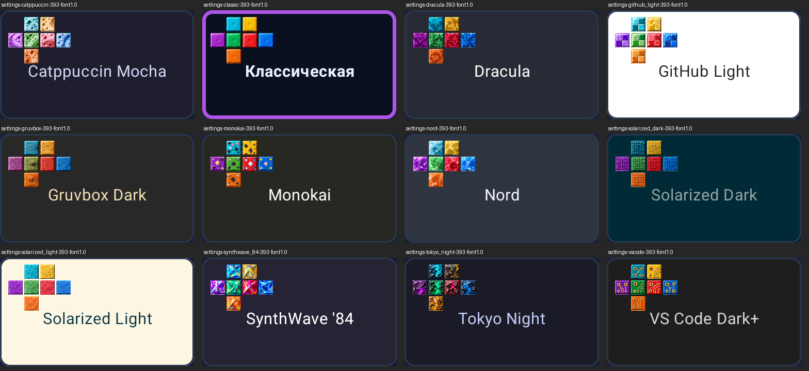

# Connected materials integration (#269)

## Behavior and source

This unreleased follow-up replaces the twelve block atlases with the owner's exact lossless WebP files from [pinned asset handoff 449a63f](https://github.com/RoyMatus/Swypetris/tree/449a63ff1d3e1d327ed214e461bfe9f4d4845e1d/publishing/design/connected-materials-269/package). All twelve file hashes matched the supplied checksum list before copying. It is outside published v1.6.0; no new release or RuStore submission is implied.

Each displayed cell now selects its shape, canonical cell and orientation. Cells retain that identity after locking, non-adjacent row removal and save/restore. Format-five saves carry appearance metadata; format-four saves retain all playable state and use cell zero / zero rotation for old settled cells whose historical identity cannot be recovered. Subsequent placements acquire real metadata. The gameplay rules version does not change and no additional records/session reset occurs.

Square source cells rotate before destination stretching; O retains effective zero rotation. Active canonical indices are assigned before spawn clipping. Settings retain their existing seven-sample arrangement, with canonical cell zero representing each shape. Hold uses canonical cells but keeps its existing opacity until the separately ordered #271. Field backgrounds, photo precedence, ghost/Next behavior, geometry, score, collision and particle trajectories/timing are unchanged.

Four fragments crop the corresponding displayed quadrants from the same decoded theme atlas. The renderer performs no bitmap creation, copying or decoding per cell, fragment or frame. Theme changes select the current shared material; fragment metadata contains no cached theme bitmap. The native ownership test checks the shared material instance, while pixel tests verify actual selected source regions. This is not a measured process-allocation/RSS claim.

## Risk-based verification

One verification owner uses the diagnosed local 8-CPU host, four Gradle workers and headless API-35 `emulator-5560`. Host profile: `host-20261013-124007-871/profile.json`. No cloud Actions were dispatched.

| Risk | Development evidence |
| --- | --- |
| Identity lost when locking, partially clearing or entering hidden lock-out | 23 selected JVM cases passed in 27.501 s, including four new `BlockAppearanceTest` cases and existing engine/Hold/clear checks |
| Saved game reset or stale metadata serialization | Three `ConnectedSessionTest` cases and two existing `SessionWriteTest` cases passed in the initial native checkpoint |
| Incorrect atlas, quarter turn, anisotropic scaling or repeated whole-cell shards | `ConnectedMaterialRenderingTest` checks all 12 themes × 7 shapes × 4 canonical cells × 4 orientation values; independent square-pixel oracle and native filtered-stretch comparison, with quadrant reconstruction |
| Theme switch or portrait UI regression | Native material/gameplay/Settings and explosion checks passed; 240 × 580 dp at font scale 2 and 393 × 873 dp at scale 1 |
| Clear clock, clipping, settling or reduced-motion regression | Existing `LineClearUiTest` cases passed in the initial checkpoint; particle motion equality is also checked in JVM tests |
| Static/API regressions | Debug lint including tests, detekt, complete JVM suite and JaCoCo completed successfully; Gradle 38 s |

The initial 13-case Android checkpoint had twelve passes and one failure in a new test oracle (95.133 s wrapper). It compared an interpolated, enlarged pixel directly with an unfiltered source pixel. The corrected oracle first checks the square rotation and then compares like-for-like filtered enlargement with a stricter channel-rounding tolerance. Four native rendering cases subsequently passed in 37.617 s. A separate explicit capture/measurement invocation passed all four cases in 50.745 s, including export/pull overhead. Its first direct invocation found no instrumentation package because Gradle had removed it; reinstalling the already built test APK resolved that setup error. No production behavior was changed to bypass either failure.

Static analysis initially identified seven style issues, then one excessive nesting issue in the added clipping test. Constants, formatting and a focused assertion helper resolved them without disabling rules. Failed logs remain under ignored verification output. The final exact-head gate is recorded separately in the implementation PR; development checkpoints do not authorize merge.

The added spawn-clipping test compares visible artwork before/after a five-row translation for all seven shapes and four rotations. Its initial exact hardware-pixel comparison differed by four red-channel levels in the first case; a bounded 0.04 channel tolerance accommodates translated hardware filtering while the independent software source oracle retains its three-level tolerance. The final four-case material checkpoint, including clipping, passed in 42.293 s. The preceding seven-case run also confirmed all three migrated-session cases after the parser refactor. Complete JVM count: 158 passed, zero skips/failures.

## Native visual evidence

These contact sheets contain actual Android-rendered captures, downscaled and labelled for review. The figure sheet uses the production native renderer without board spacing so adjacent canonical regions can be compared; gameplay retains the existing 7% inset. Original full-size captures for both portrait configurations remain in local `app/build/verification/epic-236/issue-269-render-evidence/`. All twelve themes were visually inspected against the pinned material direction. Pixel checks establish sampled-region correctness, not an independent aesthetic judgment or human playtest.

## Packaging and measurements

Comparable debug-variant APK inspection used the immutable pre-change `f5b228d` APK and the #269 development APK. It found exactly twelve new block WebP atlases and twelve unchanged field images. Each packaged atlas matched its runtime source bytes; all field hashes matched the baseline. Superseded atlases, figure/shard PNGs, source/reference sheets, ZIP and full provenance manifest are absent from the APK. The review images above are repository documentation, not Android resources.

| Bytes | Before | After | Difference |
| --- | ---: | ---: | ---: |
| Block texture payload (also stored ZIP bytes) | 6,832,584 | 7,020,602 | +188,018 |
| Complete debug APK | 63,258,314 | 64,262,590 | +1,004,276 |

The complete APK difference includes code, resource-table and archive overhead; it is not attributed entirely to textures. These are debug files, not a prediction of signed release/download size. The final built artifact inventory is checked again for delivery.

RGBA pixel-storage estimate: one 924 × 528 atlas uses 1,951,488 bytes (about 1.86 MiB); twelve use 23,417,856 bytes (about 22.33 MiB), excluding object/driver overhead. This is not measured process RSS or a guarantee that all twelve stay decoded concurrently.

The optional cached software-Canvas probe draws 200 cells per frame, ten warm-ups and twenty measured frames per theme/size. Median per-frame time across twelve themes was 14.306 → 15.041 ms at 74-pixel cells, and 2.057 → 2.337 ms at 24-pixel cells. Before/after ranges were 13.823–23.596 / 14.783–16.006 ms and 1.943–3.563 / 2.234–2.616 ms respectively. These single-session emulator CPU samples do not measure GPU presentation, physical-device FPS, statistical significance or causality. Atlas sharing avoids a new bitmap per shard; the results do not justify claiming zero performance cost.

Raw evidence: `issue-269-texture-sizes.json`, `issue-269-apk-inventory.json`, `issue-269-draw-summary.json`, baseline/current CSVs and retained native logs under local `app/build/verification/epic-236/`.
